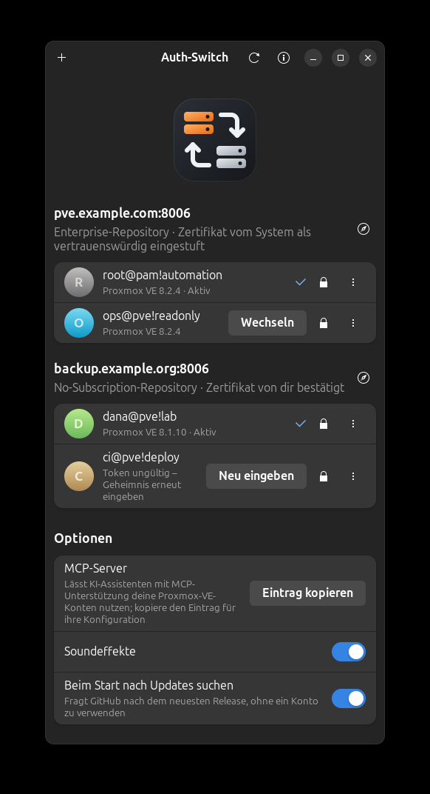

<p align="center">
  
</p>

<h1 align="center">Auth-Switch</h1>

<p align="center">
  Mit einem Klick zwischen Proxmox-VE-Konten wechseln.<br>
  <a href="README.md">English</a> · <b>Deutsch</b>
</p>

<p align="center">
  
</p>

Eine kleine GTK-App, die API-Tokens für Proxmox VE sicher verwahrt und das
aktive Konto pro Server wechselt – im Fenster, auf der Kommandozeile, für
andere Werkzeuge wie Terraform oder Ansible und für KI-Assistenten über den
mitgelieferten MCP-Server. Auth-Switch basiert auf
[Git-Switch](https://github.com/SoulInfernoDE/gitswitch).

## Funktionen

- Konten sind API-Tokens (`benutzer@realm!name`); mehrere pro Server, eines aktiv
- Findet beim Hinzufügen eines Kontos Proxmox-VE-Server in deinen lokalen Netzen
- Zeigt pro Konto, ob das Token noch funktioniert, und die Proxmox-VE-Version
- Server mit selbstsigniertem Zertifikat – bei Proxmox VE der Standard – werden
  auf den Fingerabdruck festgelegt, den du einmal bestätigt hast
- Per Schalter festlegen, was ein Token darf – Gäste lesen, benutzen oder
  verwalten, Speicher, Konten, Netzwerke oder Knoten verwalten (Proxmox-VE-Rollen)
- Einem Token den Zugriff auf einzelne Gäste, Speicher oder Knoten über ein
  Dropdown im Eintrag verweigern
- Prüft beim Hinzufügen das Abonnement und zeigt, ob der Server das
  Enterprise- oder das No-Subscription-Repository nutzt; ohne Abonnement kann
  es die Repositories umstellen und den Hinweis „No valid subscription“
  dauerhaft entfernen
- Zeigt ausstehende Updates pro Knoten, upgradet einen Knoten und stellt die
  Standardsprache der Weboberfläche ein
- Richtet SSH als root für dein eigenes Terminal ein und schaltet es ein und aus
- Ändert das Passwort eines Kontos in einer VM oder einem Container oder benennt
  es um, ohne dass der alte Name zurückbleibt
- Startet andere Werkzeuge mit dem aktiven Konto: `auth-switch exec -- terraform plan`
- MCP-Server mit Lese- und Schreibzugriff auf die Proxmox-VE-API
- Leak-Prüfung: findet Token-Geheimnisse, Serveradressen, deine echte
  E-Mail-Adresse und ähnliche private Daten, bevor sie veröffentlicht werden
- Sucht beim Start nach einer neueren Version
- Dezente Soundeffekte, Oberfläche auf Englisch und Deutsch

## Installation

Benötigt Python ≥ 3.10, GTK 4, libadwaita ≥ 1.4, libsecret und einen laufenden
Schlüsselbund (GNOME Keyring, KWallet o. Ä.).

**Debian / Ubuntu / Linux Mint** – das `.deb` von der
[Release-Seite](../../releases) herunterladen und installieren:

```bash
sudo apt install ./auth-switch_0.4.0_all.deb
```

**Andere Distributionen** – PyGObject, GTK 4, libadwaita und libsecret über den
Paketmanager installieren, dann:

```bash
pipx install --system-site-packages auth_switch-0.4.0-py3-none-any.whl
```

## Konto hinzufügen

1. In der Proxmox-VE-Weboberfläche **Rechenzentrum → Berechtigungen →
   API-Token** öffnen und ein Token anlegen. *Separierung der Privilegien* ist
   standardmäßig angehakt: Ein solches Token hat keine Rechte, bis du sie dem
   Token selbst erteilst. Für ein Verwaltungs-Token von `root@pam` – nötig für
   Berechtigungen, Repositories, Updates und Sprache – das Häkchen entfernen;
   für ein eingeschränktes Token es behalten und Rollen mit **Berechtigungen …**
   erteilen. Auth-Switch weist darauf hin, wenn ein neues Token gar keine Rechte
   hat.
2. In Auth-Switch **+** drücken. Auth-Switch durchsucht deine lokalen Netze
   nach Proxmox-VE-Servern und trägt die Adresse des ersten gefundenen ein;
   wähle einen anderen aus der Liste oder gib eine Adresse ein. Dann Token-ID
   (`benutzer@realm!name`) und Geheimnis eingeben.
3. Vertraut dein System dem Zertifikat des Servers nicht, zeigt Auth-Switch
   dessen SHA-256-Fingerabdruck. Vergleiche ihn mit **Knoten → System →
   Zertifikate** oder `pvenode cert info` auf dem Server und bestätige nur,
   wenn er übereinstimmt.

## Berechtigungen

**Berechtigungen …** im Menü eines Kontos zeigt Schalter für die eingebauten
Proxmox-VE-Rollen, zum Beispiel *Gäste benutzen* (PVEVMUser), *Gäste verwalten*
(PVEVMAdmin) oder *Konten verwalten* (PVEUserAdmin), und erteilt oder entzieht
sie dem Token für den ganzen Server (Pfad `/`). Rechte auf anderen Pfaden
bleiben unverändert. Zum Ändern braucht es ein Konto, das Berechtigungen ändern
darf, meist ein Token von `root@pam`; der Dialog nimmt dafür ein anderes Konto
desselben Servers und lässt dich eines auswählen. Ein Token ohne
Privilegientrennung hat immer alle Rechte seines Benutzers; darauf weist der
Dialog hin.

### Zugriff auf einzelne Gäste

Der Schloss-Knopf im Eintrag eines Kontos öffnet ein Dropdown mit allen
virtuellen Maschinen, Containern, Speichern und Knoten des Clusters.
Ausschalten verweigert dem Token den Zugriff darauf mit der Rolle *NoAccess*,
die weiter gefasste Rechte wie eine Rolle auf `/` übersteuert; Einschalten
entfernt diesen Eintrag wieder. Wie bei den Rollen geschieht das mit einem
anderen Konto des Servers, auswählbar unten im Dropdown.

Der MCP-Server hält sich zusätzlich selbst an diese Sperren: Er lehnt Aufrufe
ab, die einen gesperrten Gast, Speicher oder Knoten betreffen, und lässt sie in
Listen weg. Das wirkt auch bei einem Token ohne Privilegientrennung, das der
Server nicht einschränkt – aber nur für den MCP-Server, nicht für
`auth-switch exec` oder andere Werkzeuge. Für ein solches Token erteilt **Auf
dem Server durchsetzen** ihm *Administrator* auf `/` und schaltet danach die
Privilegientrennung ein: Es behält alle Rechte, und seine Sperren gelten für
jeden Zugriff. Ein Token, das sich selbst etwas gesperrt hat, darf dort keine
Rechte mehr ändern; zum Aufheben schaltet Auth-Switch die Privilegientrennung
kurz aus und wieder ein.

## Server ohne Abonnement

Nach dem Hinzufügen eines Kontos – und jederzeit über **Abonnement und
Repository …** in seinem Menü – zeigt Auth-Switch eine Checkliste für den
Server:

- **Abonnement** jedes Knotens.
- **Paket-Repositories:** Ohne Abonnement schaltet *Umstellen* über die
  Proxmox-VE-API die No-Subscription-Repositories ein (auch Ceph) und die
  Enterprise-Repositories ab – für `.list`-Dateien von PVE 8 wie
  `.sources`-Dateien von PVE 9.
- **Hinweis „No valid subscription“:** gelesen aus der Datei, die die
  Weboberfläche für alle ausliefert, daher zeigt die Checkliste den echten
  Zustand, auch nach Updates. Sie erkennt auch das verbreitete Rezept, das den
  Dialog auskommentiert und damit stillschweigend die Aktionen dahinter
  blockiert, etwa „Repository hinzufügen“.

Entfernen oder Reparieren ändert eine Datei auf dem Knoten und richtet einen
APT-Hook ein (`/usr/local/sbin/pve-subscription-notice-hook` und
`/etc/apt/apt.conf.d/99-pve-subscription-notice`), der die Änderung nach jedem
Update von `proxmox-widget-toolkit` beibehält. Er ändert nur die Abo-Prüfung,
sodass die Aktionen hinter dem Hinweis weiter funktionieren, und macht den
auskommentierten Dialog anderer Rezepte rückgängig; die zuletzt geänderte Datei
bleibt als `proxmoxlib.js.auth-switch.orig` erhalten. Weil das root braucht,
gibt es drei Wege, und der Dialog zeigt das Skript, bevor etwas läuft:

- **Mit Passwort ausführen:** Passwort von `root@pam` eingeben. Auth-Switch
  meldet sich einmal an, führt das Skript in der eigenen Root-Konsole des
  Knotens aus – der hinter Knoten → Shell – über die HTTPS-Verbindung, deren
  Zertifikat du bestätigt hast, und vergisst Passwort und Sitzung sofort. Bei
  Zwei-Faktor-Anmeldung fragt es nach dem Einmalcode. SSH ist nicht beteiligt.
- **Per SSH**, wenn SSH als root mit deinen Schlüsseln und bekanntem Host-Key
  bereits funktioniert.
- **Selbst erledigen:** kopiert einen einzeiligen Befehl und öffnet die
  Weboberfläche; anmelden, Shell des Knotens öffnen und einfügen. Die
  Checkliste merkt von selbst, wenn der Hinweis weg ist.

Zum Lesen braucht es das Recht `Sys.Audit` auf den Knoten, zum Umstellen der
Repositories `Sys.Modify`, meist mit einem Token von `root@pam`.

## Updates und Sprache

**Updates und Sprache …** im Menü eines Kontos zeigt Proxmox-VE-Version und
ausstehende Updates jedes Knotens und stellt die Standardsprache der
Weboberfläche für den ganzen Cluster ein – oder überlässt sie dem Browser.

**Upgraden** installiert alle ausstehenden Updates eines Knotens mit
`apt dist-upgrade`, wie der Upgrade-Knopf der Weboberfläche. Ein Klick genügt:
Funktioniert SSH als root – mit dem Schlüssel von **SSH für mein Terminal** oder
einem eigenen –, läuft das Upgrade sofort mit Fortschrittshinweis durch. Sonst
bietet es die Upgrade-Konsole der Weboberfläche an, die nach der Anmeldung jeden
Schritt zeigt, sowie die SSH-Einrichtung.

Ist ein neuerer Kernel installiert als der laufende, zeigt der Knoten
*Neustart ausstehend* und einen Knopf **Neu starten**, und nach einem Upgrade
fragt Auth-Switch sofort nach. Die Frage nennt die laufenden Gäste: Sie werden
vorher heruntergefahren, und die mit *Beim Booten starten* kommen von selbst
zurück. Danach wartet Auth-Switch und meldet, sobald der Knoten wieder
antwortet. Es bleibt
innerhalb der installierten Hauptversion; für die nächste verlinkt der Dialog
die offizielle Upgrade-Anleitung, weil ein Hauptversions-Upgrade Vorbereitung
braucht, die nicht unbeaufsichtigt laufen sollte.

Zum Lesen braucht es `Sys.Audit`, zum Ändern der Sprache und für die
Update-Suche `Sys.Modify`, meist mit einem Token von `root@pam`.

## SSH für dein eigenes Terminal

**SSH für mein Terminal …** im Menü eines Kontos richtet `ssh NAME` als root für
den Server ein, etwa um in einem Terminal zu arbeiten, das dir besser liegt als
die Web-Konsole. Auth-Switch erzeugt einen Schlüssel nur für diesen Server, lässt
root auf dem Server ihm über die Root-Konsole vertrauen (mit dem root-Passwort,
einmal verwendet) und übernimmt den SSH-Host-Key des Servers über die bereits
bestätigte HTTPS-Verbindung – kein blindes „yes“ für einen unbekannten Host. Es
ergänzt eine `Include`-Zeile oben in `~/.ssh/config`; die eigenen Einträge liegen
in `~/.ssh/auth-switch/`.

Der private Schlüssel liegt im System-Schlüsselbund. **Aus** löscht sofort die
Kopie, die ssh nutzt, und ihren Eintrag, sodass ssh sich damit nicht mehr
anmelden kann; Schlüsselbund und Server behalten den Schlüssel, daher geht
**An** wieder ohne Passwort. **Entfernen** trägt den Schlüssel vom Server aus und
löscht ihn aus dem Schlüsselbund. Ausschalten sperrt nie den Schlüsselbund
selbst.

Solange der Zugang an ist, kann sich jedes Programm unter deinem Benutzer –
auch ein KI-Assistent mit Shell-Zugriff – ohne Rückfrage als root anmelden; das
Fenster sagt das in einem hervorgehobenen Hinweis. Der MCP-Server hat kein Tool
dafür und erfährt nichts davon.

### Benutzerkonten in Gästen

Jede virtuelle Maschine und jeder Container in diesem Dropdown hat einen Knopf
**Benutzerkonten …**. Er listet die Konten, mit denen man sich anmeldet –
aktivierte lokale Benutzer unter Windows, root und reguläre Benutzer unter
Linux – und bietet:

- **Passwort ändern:** bei VMs über den eigenen Passwort-Aufruf des
  Gast-Agenten, bei Containern über `chpasswd` mit dem Passwort auf der
  Standardeingabe; es steht nie in einer Befehlszeile im Gast, und Auth-Switch
  speichert es nicht.
- **Umbenennen:** zeigt zuerst eine Vorschau und benennt das Konto dann sauber
  um. Unter Windows: Konto, Anzeigename (falls gesetzt), Profilordner samt
  Registry-Eintrag sowie den alten Profilpfad in den Registry-Dateien des
  Benutzers (`NTUSER.DAT`, `UsrClass.dat`) und in der System-Registry. Unter
  Linux: Konto, primäre Gruppe, Home-Verzeichnis, Anzeigename, Crontab,
  Postfach, untergeordnete IDs und sudo-Regeln (nur übernommen, wenn `visudo`
  sie akzeptiert). Danach nennt es jede Stelle, die das alte Konto noch nennt.
  Das Konto muss dafür abgemeldet sein.

VMs brauchen einen laufenden QEMU-Gast-Agenten. Container haben keinen; sie
werden mit `pct exec` über den Zugang von **SSH für mein Terminal** erreicht,
der dafür eingeschaltet sein muss.

## So werden Geheimnisse geschützt

- Ein Geheimnis liegt ausschließlich im System-Schlüsselbund – nie in einer
  Datei, einer Kommandozeile oder einem Log. Ohne Schlüsselbund wird das Konto
  nicht angelegt.
- Es wird nur an den eigenen Server gesendet, nur über HTTPS. Bei einem
  festgelegten Server wird das Zertifikat vor dem Senden mit dem bestätigten
  Fingerabdruck verglichen; ein geändertes Zertifikat stoppt die Anfrage.
- Weiterleitungen werden nicht verfolgt, und API-Endpunkte, die Tickets oder
  neue Zugangsdaten ausstellen, sind gesperrt.
- Fenster, Kommandozeile und MCP-Server zeigen nie ein Geheimnis.
  `auth-switch exec` gibt es nur an die Umgebung des gestarteten Programms
  weiter.

## Benutzung

```bash
auth-switch                        # Fenster öffnen
auth-switch list                   # Konten als JSON
auth-switch switch root@pam!ops    # Wechsel aus der Shell
auth-switch exec -- terraform plan # Werkzeug mit dem aktiven Konto starten
auth-switch leak-check             # prüfen, was der nächste Push veröffentlichen würde
```

`auth-switch exec` setzt die Variablen der gängigen Werkzeuge:
`PROXMOX_VE_ENDPOINT` und `PROXMOX_VE_API_TOKEN` (Terraform-Provider bpg),
`PM_API_URL`, `PM_API_TOKEN_ID` und `PM_API_TOKEN_SECRET` (Terraform-Provider
Telmate) sowie `PROXMOX_HOST`, `PROXMOX_PORT`, `PROXMOX_USER`,
`PROXMOX_TOKEN_ID` und `PROXMOX_TOKEN_SECRET` (Ansible). Diese Werkzeuge prüfen
das Zertifikat selbst; für sie empfiehlt sich daher ein Zertifikat, dem dein
System vertraut.

## MCP-Server

Im Fenster **Eintrag kopieren** drücken und in die Konfiguration deines
MCP-Clients einfügen oder `auth-switch-mcp` als stdio-Server registrieren. Ist
Claude Code oder Claude Desktop installiert, zeigt das Fenster zusätzlich einen
Schalter **Claude-Code-Integration**, der den Server in beiden registriert und
wieder entfernt. Tools:

| Tool | Zweck |
| --- | --- |
| `list_proxmox_accounts` | Konten pro Server, das aktive, Token-Gültigkeit, Version |
| `switch_proxmox_account` | Ein anderes Token aktivieren |
| `proxmox_api_get` | Aus der API lesen: Knoten, Gäste, Speicher, Tasks … |
| `proxmox_api_write` | Etwas ändern: Gäste starten/stoppen, Snapshots, Konfiguration … |
| `check_for_leaks` | Text, Dateien oder den nächsten Push auf private Daten prüfen |

Lesen und Schreiben sind getrennte Tools, damit sich Lesen dauerhaft erlauben
lässt, während Änderungen weiterhin nachfragen. Aufrufe laufen mit den
Berechtigungen des aktiven Tokens; ein Token mit wenigen Rechten begrenzt also,
was der Assistent tun kann.

## Leak-Prüfung

| Stufe | Was gefunden wird |
| --- | --- |
| `secret` | Die Geheimnisse deiner Tokens, andere Zugriffstokens, private Schlüssel |
| `private` | Adressen deiner Proxmox-VE-Server, deine echte Git-E-Mail-Adresse, Pfade in deinem Home-Verzeichnis |
| `review` | Andere E-Mail-Adressen, der Rechnername, private Netzwerkadressen, interne Hostnamen |

`auth-switch leak-check` endet bei Funden mit Status 1 und eignet sich damit
als git-`pre-push`-Hook. Einträge unter `leak_allow` in
`~/.config/auth-switch/config.json` werden ignoriert. Begriffe, die nicht in
veröffentlichten Inhalten stehen sollen, lassen sich dort ebenfalls eintragen
und in genau einem Repository erlauben:

```json
"restricted": {
  "terms": ["Example Tool"],
  "files": ["EXAMPLE.md"],
  "repository": "git.example.com/you/notes"
}
```

Die Prüfung liest nur Text; was ein Screenshot zeigt, kann sie nicht erkennen.

## Updates

Beim Start fragen Fenster und MCP-Server GitHub nach dem neuesten Release,
höchstens alle 12 Stunden und ohne ein Konto zu verwenden. Abschalten lässt es
sich mit **Beim Start nach Updates suchen**. Installiert wird nichts
automatisch.

## Entwicklung

Programmtexte liegen als gettext-Kataloge unter `authswitch/locale/`; Englisch
ist Ausgangssprache und Fallback.

```bash
/usr/bin/python3 -m unittest discover -s tests
packaging/update-translations.sh   # Programmtexte extrahieren, Kataloge aktualisieren und kompilieren
packaging/build-deb.sh
packaging/release.sh <notes file> [<forgejo host> <forgejo owner/repo>]   # bauen, auf GitHub veröffentlichen, auf den Spiegel kopieren
```

## Lizenz

MIT
