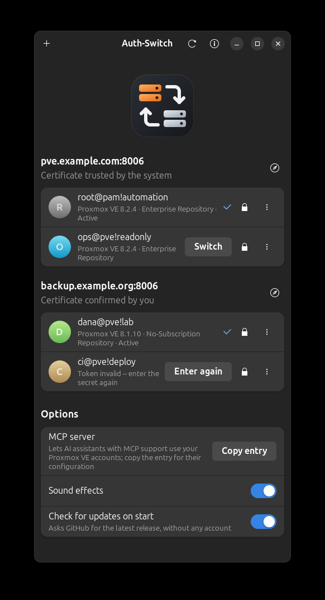

<p align="center">
  
</p>

<h1 align="center">Auth-Switch</h1>

<p align="center">
  Switch between Proxmox VE accounts with one click.<br>
  <b>English</b> · <a href="README.de.md">Deutsch</a>
</p>

<p align="center">
  
</p>

A small GTK app that keeps Proxmox VE API tokens safe and switches the active
account per server – in the window, on the command line, for other tools such
as Terraform or Ansible, and for AI assistants through the bundled MCP server.
Auth-Switch is based on [Git-Switch](https://github.com/SoulInfernoDE/gitswitch).

## Features

- Accounts are API tokens (`user@realm!name`); several per server, one active
- Finds Proxmox VE servers in your local networks when you add an account
- Shows per account whether the token still works and the Proxmox VE version
- Servers with a self-signed certificate – the Proxmox VE default – are pinned
  to the fingerprint you confirmed once
- Adjust what a token may do with switches – read, use or manage guests, manage
  storage, accounts, networks or nodes (Proxmox VE roles)
- Deny a token access to single guests, storages or nodes from a drop-down in
  its entry
- Checks the subscription when an account is added and shows whether the
  server uses the enterprise or the no-subscription repository; without a
  subscription it can switch the repositories and remove the "No valid
  subscription" notice for good
- Shows pending updates per node, upgrades a node and sets the default language
  of the web interface
- Sets up SSH as root for your own terminal and switches it on and off
- Runs other tools with the active account: `auth-switch exec -- terraform plan`
- MCP server with read and write access to the Proxmox VE API
- Leak check: finds token secrets, server addresses, your real e-mail address
  and similar private data before they are published
- Looks for a newer version on start
- Soft sound effects, English and German interface

## Install

Requires Python ≥ 3.10, GTK 4, libadwaita ≥ 1.4, libsecret and a running
keyring (GNOME Keyring, KWallet or similar).

**Debian / Ubuntu / Linux Mint** – download the `.deb` from the
[releases page](../../releases) and install it:

```bash
sudo apt install ./auth-switch_0.3.7_all.deb
```

**Other distributions** – install PyGObject, GTK 4, libadwaita and libsecret
from your package manager, then:

```bash
pipx install --system-site-packages auth_switch-0.3.7-py3-none-any.whl
```

## Adding an account

1. In the Proxmox VE web interface open **Datacenter → Permissions → API
   Tokens** and add a token. *Privilege Separation* is ticked by default: such
   a token has no rights until you grant them to the token itself. For a
   management token of `root@pam` – needed for permissions, repositories,
   updates and language – untick it; for a limited token keep it and grant
   roles with **Permissions…**. Auth-Switch tells you if a new token has no
   rights at all.
2. In Auth-Switch press **+**. Auth-Switch searches your local networks for
   Proxmox VE servers and fills in the address of the first one it finds;
   choose another from the list or type an address. Then enter the token ID
   (`user@realm!name`) and the secret.
3. If the server's certificate is not trusted by your system, Auth-Switch
   shows its SHA-256 fingerprint. Compare it with **Node → System →
   Certificates** or `pvenode cert info` on the server and confirm only if it
   matches.

## Permissions

**Permissions…** in the menu of an account shows switches for the built-in
Proxmox VE roles, for example *Use guests* (PVEVMUser), *Manage guests*
(PVEVMAdmin) or *Manage accounts* (PVEUserAdmin), and grants or revokes them for
the token on the whole server (path `/`). Rights on other paths stay as they
are. Changing permissions needs an account that may modify them, usually a
token of `root@pam`; the dialog uses another account of the same server for
that and lets you pick it. A token without privilege separation always has all
rights of its user, so the dialog points this out.

### Access to single guests

The lock button in an account's entry opens a drop-down with every virtual
machine, container, storage and node of the cluster. Switching one off denies
the token access to it with the *NoAccess* role, which overrides broader
rights such as a role on `/`; switching it on again removes that entry. Like
the roles, this is changed with another account of the server, selectable at
the bottom of the drop-down.

The MCP server keeps to these blocks itself as well: it refuses calls that touch
a blocked guest, storage or node and leaves them out of lists. That also works
for a token without privilege separation, which the server does not restrict –
but only for the MCP server, not for `auth-switch exec` or other tools. For
such a token **Enforce on the server** grants it *Administrator* on `/` and then
turns on privilege separation: it keeps all rights, and its blocks apply to
every access. A token that blocked a resource for itself loses the right to
change permissions there; to lift the block, Auth-Switch briefly turns privilege
separation off and on again.

## Servers without a subscription

After an account is added – and any time with **Subscription and
repository…** in its menu – Auth-Switch shows a checklist for the server:

- **Subscription** of every node.
- **Package repositories:** without a subscription, *Switch over* enables the
  no-subscription repositories (Ceph included) and disables the enterprise ones
  through the Proxmox VE API – for PVE 8 `.list` and PVE 9 `.sources` files
  alike.
- **"No valid subscription" notice:** read from the file the web interface
  serves to everyone, so the checklist shows the real state, also after
  updates. It also recognises the common recipe that comments out the dialog,
  which silently stops the actions behind it, such as adding a repository.

Removing or repairing the notice changes a file on the node and installs an APT
hook (`/usr/local/sbin/pve-subscription-notice-hook` and
`/etc/apt/apt.conf.d/99-pve-subscription-notice`) that keeps the change after
every update of `proxmox-widget-toolkit`. It only changes the subscription
check, so the actions behind the notice keep working, and it undoes the
commented-out dialog of other recipes; the file it changed last is kept as
`proxmoxlib.js.auth-switch.orig`. Because this needs root, there are three ways,
and the dialog shows the script before anything runs:

- **Run with password:** enter the password of `root@pam`. Auth-Switch signs in
  once, runs the script in the node's own root console – the one behind Node →
  Shell – over the HTTPS connection whose certificate you confirmed, and
  forgets the password and the session right away. With two-factor
  authentication it asks for the one-time code. No SSH is involved.
- **Over SSH**, if SSH as root already works with your keys and a known host
  key.
- **Do it myself:** copies a one-line command and opens the web interface; sign
  in, open the node's Shell and paste it. The checklist notices by itself when
  the notice is gone.

Reading needs the right `Sys.Audit` on the nodes and switching repositories
`Sys.Modify`, usually with a token of `root@pam`.

## Updates and language

**Updates and language…** in an account's menu shows the Proxmox VE version and
the pending updates of every node and sets the default language of the web
interface for the whole cluster – or leaves it to the browser.

**Upgrade** installs all pending updates of a node with `apt dist-upgrade`, the
same as the Upgrade button of the web interface: either in that button's own
upgrade console in the browser, where you see every step, or unattended over
SSH as root with your existing keys. Afterwards Auth-Switch tells you if a new
kernel needs a reboot. It stays within the installed major version; for the
next one the dialog links the official upgrade guide, because a major upgrade
needs preparation that should not run unattended.

Reading needs `Sys.Audit`, changing the language and checking for updates
`Sys.Modify`, usually with a token of `root@pam`.

## SSH for your own terminal

**SSH for my terminal…** in an account's menu sets up `ssh NAME` as root for the
server, for example to work in a terminal that suits you better than the web
console. Auth-Switch creates a key for this server only, lets root on the server
trust it through the root console (with the root password, used once), and takes
the server's SSH host key over the HTTPS connection you already confirmed, so
there is no blind "yes" for an unknown host. It adds one `Include` line at the
top of `~/.ssh/config`; its own entries live in `~/.ssh/auth-switch/`.

The private key is kept in the system keyring. **Off** deletes the copy ssh uses
and its entry right away, so ssh can no longer log in with it; the keyring and
the server keep the key, so **on** works again without the password. **Remove**
takes the key off the server and out of the keyring. Switching off never locks
the keyring itself.

While access is on, any program running as you – including an AI assistant
with shell access – can log in as root without asking; the window says so in a
highlighted note. The MCP server has no tool for it and is not told about it.

## How secrets are protected

- A secret is stored in the system keyring only – never in a file, a command
  line or a log. Without a keyring the account is not added.
- It is sent only to its own server, only over HTTPS. For a pinned server the
  certificate is checked against the confirmed fingerprint before anything is
  sent; a changed certificate stops the request.
- Redirects are not followed, and API endpoints that issue tickets or new
  credentials are blocked.
- The window, the command line and the MCP server never show a secret.
  `auth-switch exec` hands it only to the environment of the program it
  starts.

## Usage

```bash
auth-switch                        # open the window
auth-switch list                   # accounts as JSON
auth-switch switch root@pam!ops    # switch from the shell
auth-switch exec -- terraform plan # run a tool with the active account
auth-switch leak-check             # check what the next push would publish
```

`auth-switch exec` sets the variables of the common tools:
`PROXMOX_VE_ENDPOINT` and `PROXMOX_VE_API_TOKEN` (Terraform provider bpg),
`PM_API_URL`, `PM_API_TOKEN_ID` and `PM_API_TOKEN_SECRET` (Terraform provider
Telmate) and `PROXMOX_HOST`, `PROXMOX_PORT`, `PROXMOX_USER`,
`PROXMOX_TOKEN_ID` and `PROXMOX_TOKEN_SECRET` (Ansible). Those tools verify the
certificate themselves, so for them a certificate your system trusts is
recommended.

## MCP server

Press **Copy entry** in the window and add it to the configuration of your MCP
client, or register `auth-switch-mcp` as a stdio server. Tools:

| Tool | Purpose |
| --- | --- |
| `list_proxmox_accounts` | Accounts per server, the active one, token validity, version |
| `switch_proxmox_account` | Activate another token |
| `proxmox_api_get` | Read from the API: nodes, guests, storage, tasks … |
| `proxmox_api_write` | Change things: start/stop guests, snapshots, configuration … |
| `check_for_leaks` | Check text, files or the next push for private data |

Reading and writing are separate tools so that reading can be allowed
permanently while changes still ask for confirmation. Calls run with the
permissions of the active token, so a token with limited rights limits what the
assistant can do.

## Leak check

| Severity | What is found |
| --- | --- |
| `secret` | The secrets of your tokens, other access tokens, private keys |
| `private` | Addresses of your Proxmox VE servers, your real git e-mail address, paths in your home directory |
| `review` | Other e-mail addresses, the computer name, private network addresses, internal host names |

`auth-switch leak-check` exits with status 1 if it finds something, so it works
as a git `pre-push` hook. Entries under `leak_allow` in
`~/.config/auth-switch/config.json` are ignored. Terms you want to keep out of
published content can be listed there as well and allowed in exactly one
repository:

```json
"restricted": {
  "terms": ["Example Tool"],
  "files": ["EXAMPLE.md"],
  "repository": "git.example.com/you/notes"
}
```

The check reads text only; it cannot see what a screenshot shows.

## Updates

On start the window and the MCP server ask GitHub for the latest release, at
most every 12 hours and without using any account. Turn it off with **Check
for updates on start**. Nothing is installed automatically.

## Development

Program texts live in gettext catalogs under `authswitch/locale/`; English is
the source language and the fallback.

```bash
/usr/bin/python3 -m unittest discover -s tests
packaging/update-translations.sh   # extract program texts, update and compile the catalogs
packaging/build-deb.sh
packaging/release.sh <notes file> [<forgejo host> <forgejo owner/repo>]   # build, release on GitHub, copy to the mirror
```

## License

MIT
